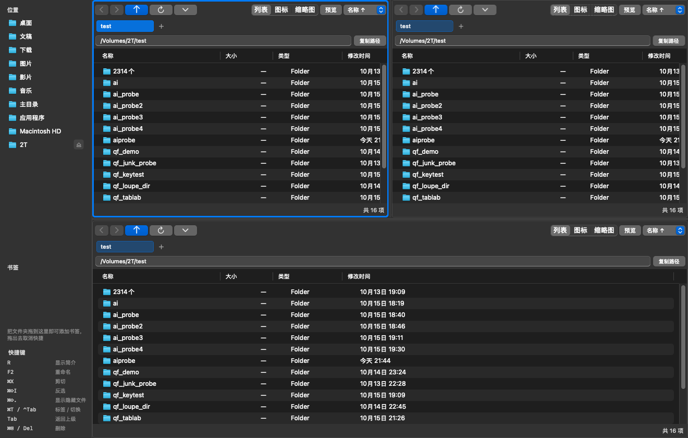
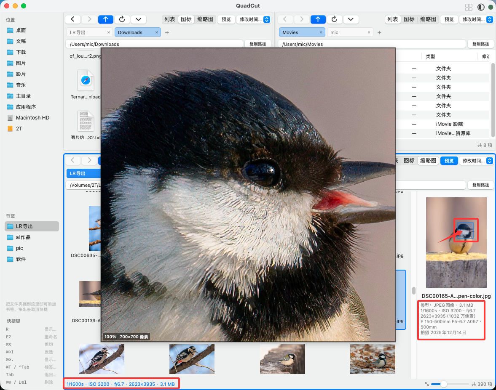
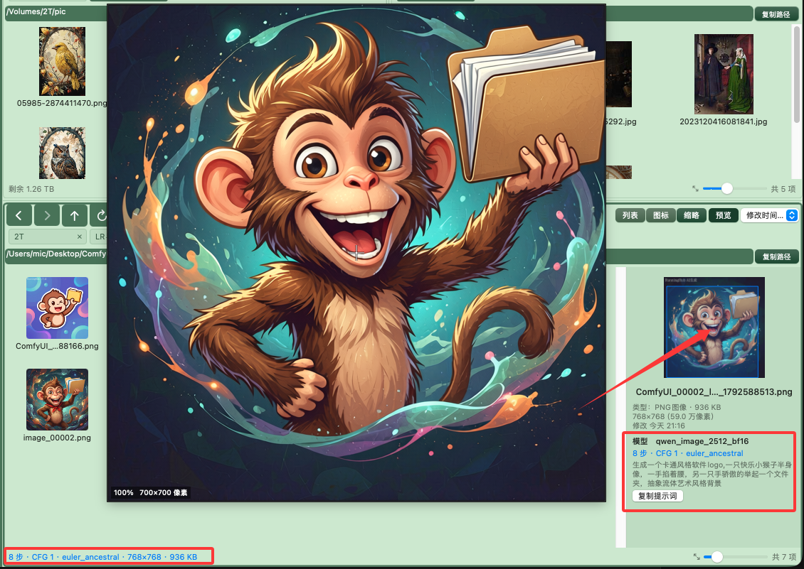
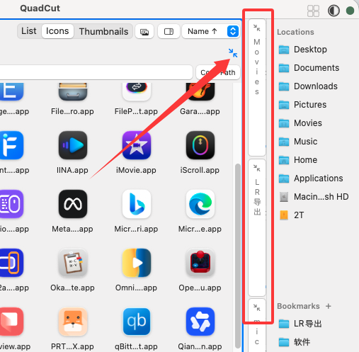
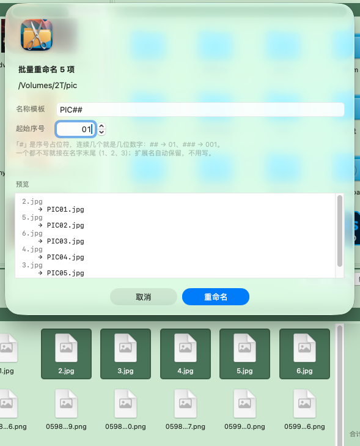
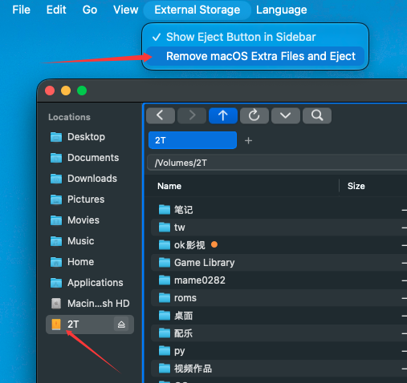
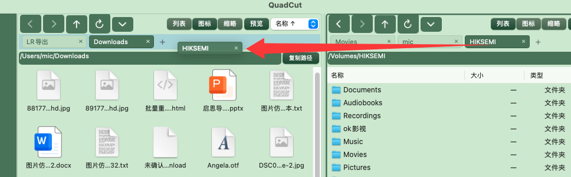

# QuadCut

**A multi-pane file manager, built for quick handling and easy sorting.**

[简体中文](README.md) · [繁體中文](README.zh-TW.md) · English · [日本語](README.ja.md) · [한국어](README.ko.md)


Back when I was new to the Mac, I handled a lot of photos and files every day, and the same thoughts kept running through my head: I need a Cut key, I need a Cut key. I want to compare file sizes quickly. I want to pick the sharpest frame out of a 20-shot burst at a glance, and compare file sizes while I am at it. And I want to batch rename 30 photos in one go…

So QuadCut exists — a photo- and image-friendly multi-pane file manager, built with the help of an AI agent. It keeps some Windows shortcut habits, and the core is four panes working together, a built-in Cut, batch renaming, and holding one key to instantly see a 100% detail.

Beyond everyday file handling, it lends a hand with photos and AI images: it reads out ISO, shutter speed and aperture on its own, and recognises and displays the model, sampler and prompt of AI images (ComfyUI). Two colour themes, five UI languages.

For what changed in each release, see the [changelog](CHANGELOG.md) (Chinese and English).

---

## Four panes, four layouts



Four panes side by side, four arrangements, switchable at any time.

## Cut really means cut

`⌘X` marks, `⌘V` in the target pane **moves** — it is not a copy.

## One key to check focus

Hover over the preview image and hold `⌃` or `⌥`, or just click the middle button, and a 100% loupe pops up instantly. When you are culling a burst, this is the most direct way to tell whether the focus landed.

## Photo EXIF at a glance



Select a photo and the status bar shows shutter, ISO, aperture and dimensions; the preview sidebar adds lens, focal length and capture time.

## AI image parameters, read straight out



Select an image made by ComfyUI or A1111 and the model, steps, CFG, sampler and prompt are read straight out, with one button to copy the whole thing.

## One Click to Expand



Suddenly need to focus on a single folder? Click to expand and you get all the room you need. Each pane has a faint little dot in its top-right corner — click it and that pane fills the whole workspace while the others collapse into a narrow strip. Click the dot again, or click any strip, and everything returns exactly to how it was. When you're grinding through one folder among many, you don't have to rearrange the layout or remember where you dragged things.

## Batch rename



Select a few items and press `F2`; `PIC##` becomes `PIC01`, `PIC02`… Either all of them change, or none do.

## External drive cleanup: leave the disk clean



Once a USB stick or portable drive has been used on a Mac, it carries `.DS_Store`, `._xxx`, `.Spotlight-V100` and other hidden files — hand it to a Windows PC or someone else's computer and it is just a pile of junk nobody understands.

The menu item "External Storage → Remove macOS extra files and eject" wipes them and ejects in one go, asking you first. The `⏏` in the sidebar is a plain eject — it ejects without cleaning.

## Tabs move around



Up to six tabs per pane. Drag them to reorder, drag one into another pane, or drag it into the sidebar to turn it into a bookmark.

## Jump by letter

Type a letter or a digit and jump straight to the item starting with it; Chinese names match by pinyin initial. Press the same key again to step to the next one.

---

## Other

- Three views: detailed list / icon grid / large thumbnails
- Search (`⌘F`): current folder and subfolders, with `*` `?` wildcards
- Images only, sort by capture time, rotation in the Edit menu (JPG / HEIC / TIFF, EXIF only, no re-encoding)
- Undo / redo, reopen a closed tab (`⇧⌘T`)
- Colour tags and filtering, sharing the same data as Finder
- Five UI languages, two themes
- Path address bar, Get Info, invert selection, open Terminal here

---

## Installation

[**Download the latest version →**](https://github.com/dungeonlee/QuadCut/releases/latest)

**Requirements**: macOS 13 Ventura or later, Apple Silicon (M series). Only the arm64 build is published — the file name carries `arm64`, and it **will not run on an Intel Mac**, so check your machine before downloading.

1. Download and drag `QuadCut.app` into Applications.
2. If the first launch says "QuadCut is damaged and can't be opened" — that is because the app is not signed with an Apple Developer certificate; the app itself is fine. Open Terminal and run once:
   ```bash
   xattr -cr /Applications/QuadCut.app
   ```
   Then double-click again. (If it instead says the developer cannot be verified, go to System Settings → Privacy & Security and click "Open Anyway".)
3. On first run, enable QuadCut under System Settings → Privacy & Security → **Full Disk Access**. Without it the app cannot read Desktop, Downloads or Documents.

---

## Shortcuts

| Action               | Classic (default)                           | Mac Default                  |
| -------------------- | ------------------------------------------- | ---------------------------- |
| Go up                | `Tab` (or `⌘↑`)                             | `⌘↑`                         |
| Open selection       | `Return` / `⌘↓` / double-click               | `⌘↓` / double-click          |
| Back / forward       | `⌘[` / `⌘]`                                 | same                         |
| Refresh              | `F5`                                        | `⌘R`                         |
| Cut / copy / paste   | `⌘X` / `⌘C` / `⌘V`                          | same                         |
| Duplicate            | `⌘D`                                        | same                         |
| Move to Trash        | `Del` (PC key) / `⌘⌫`                       | `⌘⌫`                         |
| New folder           | `⇧⌘N`                                       | same                         |
| Rename / batch rename | `F2`                                       | `Return`                     |
| Maximize / restore pane | `F1`                                     | `⌥⌘F`                        |
| Get Info             | `⌘R` / `⌥R`                                 | `⌘I` / `⌥I`                  |
| Undo / redo          | `⌘Z` / `⇧⌘Z`                                | same                         |
| Select all / invert  | `⌘A` / `⇧⌘I`                                | same                         |
| Show hidden files    | `⌘⇧.`                                       | same                         |
| Search               | `⌘F`                                        | same                         |
| Focus address bar    | `⌘L`                                        | same                         |
| Switch to pane 1–4   | `⌘1`–`⌘4`                                   | same                         |
| Switch view          | `⌥⌘1` list / `⌥⌘2` icons / `⌥⌘3` thumbnails  | same                         |
| New / cycle tab      | `⌘T` / `⌃Tab`, `⌃⇧Tab`                      | same                         |
| Reopen closed tab    | `⇧⌘T`                                       | same                         |
| Quick Look           | `Space`                                     | same                         |
| Jump by first letter | bare `A`–`Z`, `0`–`9`                       | same                         |
| 100% loupe           | hover the preview, `⌃` / `⌥` / middle click | same                         |
| Open Terminal here   | `⌃⌘T`                                       | same                         |

These two columns are **not two builds** — it's one app with two key layouts, switchable at any time.

Keys are assigned by **what is printed on the keycap**, not by copying Windows physical positions — PC and Mac keyboards both line up: go up is `Tab`, delete is `Del` / `⌘⌫`.

**How to switch**: “Edit → Shortcuts”, then pick **Classic** (default) or **Mac Default**. Takes effect immediately, no restart.

**Why two sets**: on an Apple keyboard `F1` / `F2` are screen brightness, `F5` is dictation, `Tab` moves focus, and ⌦ has no physical key on a laptop at all. Classic uses all of them (Windows muscle memory), which clashes on a built-in MacBook keyboard — so Mac Default hands them back to the system and follows Finder instead: `⌘↑` to go up, `Return` to rename, `⌘I` for Get Info, `⌘R` to refresh, `⌥⌘F` to maximize. On a Mac mini, desktop or a combined Win/Mac keyboard, just stay on Classic.

---

**Free software · Copyright © 2026 Michael**

Free to use, and the complete, unmodified copy may be redistributed free of charge, provided this notice and the complete program are kept.
Without the author's written permission, the software may not be modified, decompiled, reverse-engineered or used to create derivative works, and it may not be redistributed in any form for a fee.
The software is provided "as is", without warranty of any kind, express or implied, including but not limited to merchantability and fitness for a particular purpose.
The author accepts no liability for any loss arising from the use of, or inability to use, this software.

Copyright © 2026 Michael. All rights reserved.
