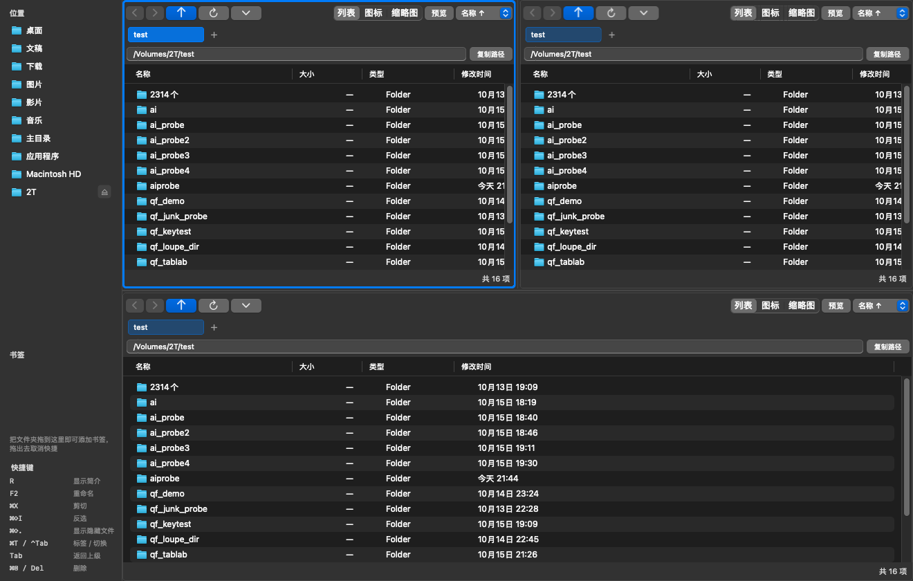
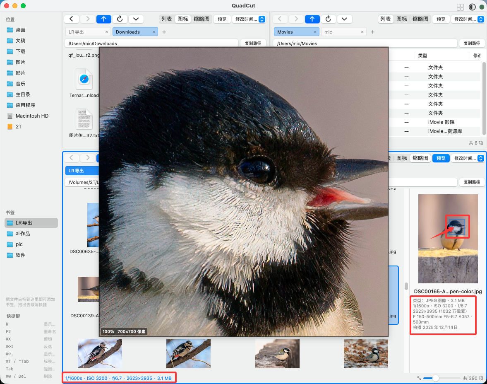
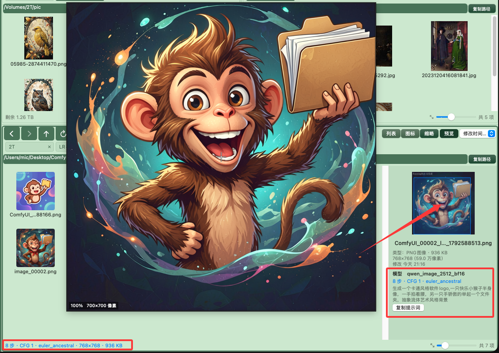
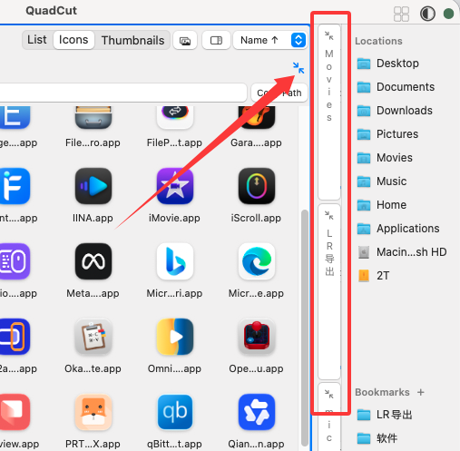
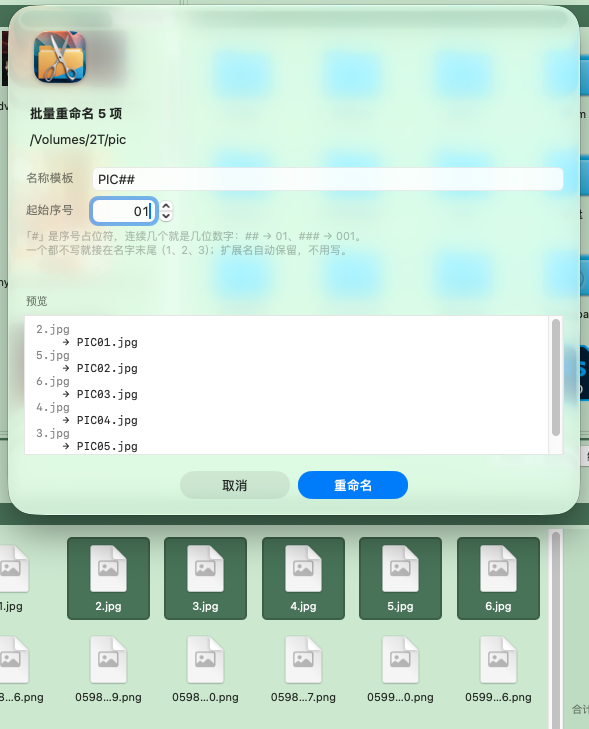
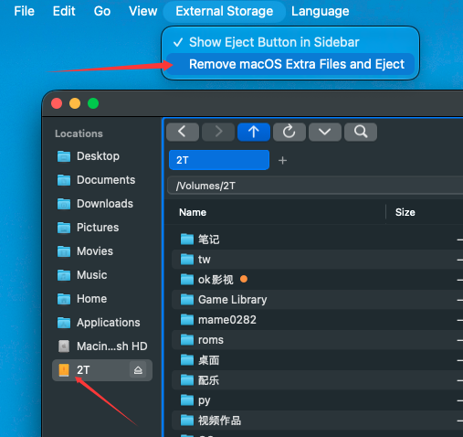
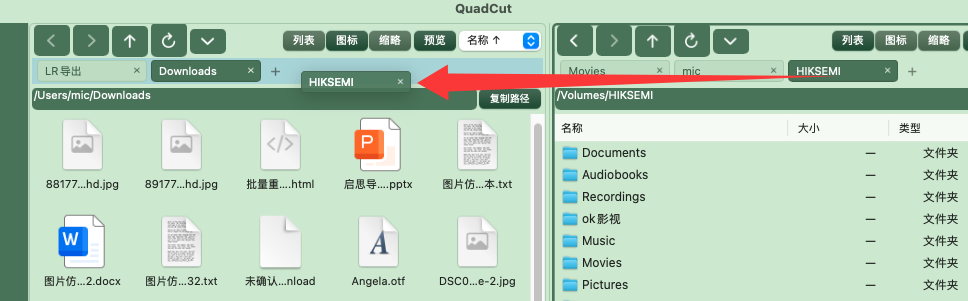

# QuadCut

**4ペインのファイルマネージャー。素早い整理と手早い選別のために。**

[简体中文](README.md) · [繁體中文](README.zh-TW.md) · [English](README.en.md) · 日本語 · [한국어](README.ko.md)


Mac を使い始めたころ、毎日たくさんの写真とファイルを扱っていて、頭の中は同じことばかりでした。カットのキーがほしい、カットのキーがほしい。ファイルサイズをすばやく見比べたい。20枚の連写からピントの合っている1枚をひと目で選びたい、ついでにサイズも比べたい。30枚の写真をまとめてリネームしたい……

そうして生まれたのが QuadCut です。AI agent の助けを借りて作った、写真と画像にやさしいマルチペインのファイルマネージャー。Windows のショートカットの癖をいくつか取り入れ、核になるのは4ペインの連携、標準搭載のカット、一括リネーム、そしてキーをひとつ押さえるだけで 100% の等倍表示です。

日常のファイル整理だけでなく、写真と AI 画像の手助けも少しだけ：ISO・シャッタースピード・絞りを自動で読み出し、AI 画像（ComfyUI）のモデル・サンプラー・プロンプトを認識して表示します。テーマは2種類、UI 言語は5種類。

各バージョンの変更点は [更新履歴](CHANGELOG.md) にまとめてあります（中国語・英語併記）。

---

## 4ペイン、4つのレイアウト



4つを並べ、並べ方は4通り。いつでも切り替えられます。

## カットはカット

`⌘X` で印を付けて、移動先のペインで `⌘V` —— これは**移動**で、コピーではありません。

## キーをひとつ押してピント確認

プレビュー画像の上で `⌃` か `⌥` を押したままにする、または中ボタンを押すだけで、100% 等倍のルーペがすぐ出ます。連写を選別するとき、ピントが合っているかを判断する最短の方法です。

## 撮影情報をすぐ表示



写真を選ぶと、ステータスバーにシャッタースピード・ISO・絞り・サイズが出ます。プレビュー側のバーにはレンズ・焦点距離・撮影日時も。

## AI 画像のパラメータをそのまま読み出し



ComfyUI や A1111 で生成した画像を選ぶと、モデル・ステップ数・CFG・サンプラー・プロンプトがそのまま読み出され、横のボタンで全文をコピーできます。

## ワンクリックで拡大



ひとつのフォルダに集中したいときは、拡大をクリックするだけ。各ペインの右上にある控えめな小さな点をクリックすると、そのペインがワークスペース全体に広がり、ほかのペインは細い列に畳まれます。もう一度点をクリックするか、細い列のどこかをクリックすれば、拡大前の状態にそのまま戻ります。たくさんのフォルダの中のひとつと向き合うとき、レイアウトを変える必要も、さっきどこまでドラッグしたかを思い出す必要もありません。

## 一括リネーム



いくつか選んで `F2`。`PIC##` は `PIC01`、`PIC02`…… 全部成功するか、1つも変わらないかのどちらかです。

## 外付けディスクの掃除：返す前にきれいに



USB メモリやポータブル HDD を Mac で使うと、`.DS_Store`、`._xxx`、`.Spotlight-V100` といった隠しファイルが残ります。Windows や他人のパソコンに渡すと、意味不明なゴミの山です。

メニューの「外付けストレージ → macOS の付加ファイルを削除して取り出す」で、まとめて消してから取り出します。実行前に一度確認します。サイドバーの `⏏` は普通の取り出しで、消さずに取り出すだけです。

## タブはドラッグで移動



1ペインにつき最大6個のタブ。ドラッグで並べ替え、別のペインへ移動、左サイドバーへドラッグすればブックマークになります。

## 頭文字でジャンプ

英字か数字を1つ打つと、その文字で始まる項目へ直接ジャンプします。中国語はピンインの頭文字で照合。同じキーを続けて押すと次々に進みます。

---

## その他

- 3つの表示：詳細リスト / アイコングリッド / 大きなサムネイル
- 検索（`⌘F`）：現在のフォルダとサブフォルダ、`*` `?` のワイルドカード対応
- 画像のみ表示、撮影日時で並べ替え、編集メニューの回転（JPG / HEIC / TIFF、EXIF のみ変更、再エンコードなし）
- 取り消し / やり直し、閉じたタブを復元（`⇧⌘T`）
- カラータグと絞り込み、Finder と同じデータを共有
- UI 言語5種類、テーマ2種類
- パスのアドレスバー、情報を見る、選択範囲の反転、ここでターミナルを開く

---

## インストール

[**最新版をダウンロード →**](https://github.com/dungeonlee/QuadCut/releases/latest)

**動作環境**：macOS 13 Ventura 以降、Apple Silicon（M シリーズ）。現在は arm64 版のみ配布しています —— ファイル名に `arm64` が入っているものが Apple Silicon 用で、**Intel Mac では動きません**。お使いのマシンを確認してからダウンロードしてください。

1. ダウンロードした `QuadCut.app` を「アプリケーション」へドラッグ
2. 初回起動で「壊れているため開けません」と出たら —— Apple の開発者署名がないためで、アプリ自体は壊れていません。「ターミナル」を開いて一度だけ実行してください：
   ```bash
   xattr -cr /Applications/QuadCut.app
   ```
   そのうえで再度ダブルクリックすれば開けます。（「開発元を検証できません」と出た場合は、「システム設定 → プライバシーとセキュリティ」で「このまま開く」を押してください。）
3. 初回起動時に「システム設定 → プライバシーとセキュリティ → **フルディスクアクセス**」で QuadCut をオンにしてください。オンにしないとデスクトップ・ダウンロード・書類が読めません。

---

## ショートカット

| 操作                | 従来（既定）                              | Mac 標準                       |
| ----------------- | ----------------------------------- | ---------------------------- |
| 上の階層へ             | `Tab`（または `⌘↑`）                    | `⌘↑`                         |
| 選択項目を開く           | `Return` / `⌘↓` / ダブルクリック           | `⌘↓` / ダブルクリック              |
| 戻る / 進む           | `⌘[` / `⌘]`                         | 同じ                           |
| 再読み込み             | `F5`                                | `⌘R`                         |
| カット / コピー / ペースト | `⌘X` / `⌘C` / `⌘V`                  | 同じ                           |
| 複製を作る             | `⌘D`                                | 同じ                           |
| ゴミ箱へ移動            | `Del`（PC キー）/ `⌘⌫`                 | `⌘⌫`                         |
| 新規フォルダ            | `⇧⌘N`                               | 同じ                           |
| リネーム / 一括リネーム     | `F2`                                | `Return`                     |
| ペインを最大化 / 元に戻す   | `F1`                                | `⌥⌘F`                        |
| 情報を見る             | `⌘R` / `⌥R`                         | `⌘I` / `⌥I`                  |
| 取り消し / やり直し       | `⌘Z` / `⇧⌘Z`                        | 同じ                           |
| すべて選択 / 選択範囲の反転   | `⌘A` / `⇧⌘I`                        | 同じ                           |
| 隠しファイルを表示         | `⌘⇧.`                               | 同じ                           |
| 検索                | `⌘F`                                | 同じ                           |
| アドレスバーへ移動         | `⌘L`                                | 同じ                           |
| ペイン 1–4 へ切り替え    | `⌘1`–`⌘4`                           | 同じ                           |
| 表示の切り替え           | `⌥⌘1` リスト / `⌥⌘2` アイコン / `⌥⌘3` サムネイル | 同じ                           |
| タブを開く / 切り替え      | `⌘T` / `⌃Tab`、`⌃⇧Tab`              | 同じ                           |
| 閉じたタブを復元          | `⇧⌘T`                               | 同じ                           |
| クイックルック           | `スペース`                              | 同じ                           |
| 頭文字でジャンプ          | 素の `A`–`Z`、数字 `0`–`9`               | 同じ                           |
| 100% で見る          | プレビュー上で `⌃` / `⌥` / 中ボタン           | 同じ                           |
| ここでターミナルを開く       | `⌃⌘T`                               | 同じ                           |

この 2 列は**別々のビルドではなく**、同じアプリの中でいつでも切り替えられる 2 種類のキー配置です。

キーは **キートップに印字されている文字**に割り当てていて、Windows の物理位置をそのまま写したものではありません —— PC キーボードでも Mac キーボードでも合います：上の階層へは `Tab`、削除は `Del` / `⌘⌫`。

**切り替え方**：メニュー「編集 → ショートカット」で **従来のショートカット**（既定）か **Mac 標準ショートカット** を選ぶだけ。すぐ反映され、再起動は不要です。

**なぜ 2 種類あるのか**：Apple のキーボードでは `F1` `F2` は画面の明るさ、`F5` は音声入力、`Tab` はフォーカス移動で、⌦ はノートブックには物理キーすらありません。従来セットはこれらを全部使う（Windows の習慣）ため、MacBook の内蔵キーボードではぶつかります —— そこで Mac 標準セットはそれらをシステムに返し、Finder の流儀に合わせます：`⌘↑` で上へ、`Return` でリネーム、`⌘I` で情報、`⌘R` で再読み込み、`⌥⌘F` で最大化。Mac mini・デスクトップ・Win/Mac 両対応キーボードなら従来のままで構いません。

---

**フリーソフト · Copyright © 2026 Michael**

無料で使用でき、本ソフトの完全な無改変の複製を無償で再配布できます。その際は本声明と完全なプログラムを保持してください。
作者の書面による許可なく、改変・逆コンパイル・リバースエンジニアリング・派生作品への利用はできません。また、いかなる形式でも有償で再配布することはできません。
本ソフトは「現状のまま」提供され、明示・黙示を問わずいかなる保証も付きません。商品性および特定目的への適合性を含みますが、これらに限りません。
作者は、本ソフトの使用または使用不能により生じたいかなる損害についても責任を負いません。

Copyright © 2026 Michael. All rights reserved.
