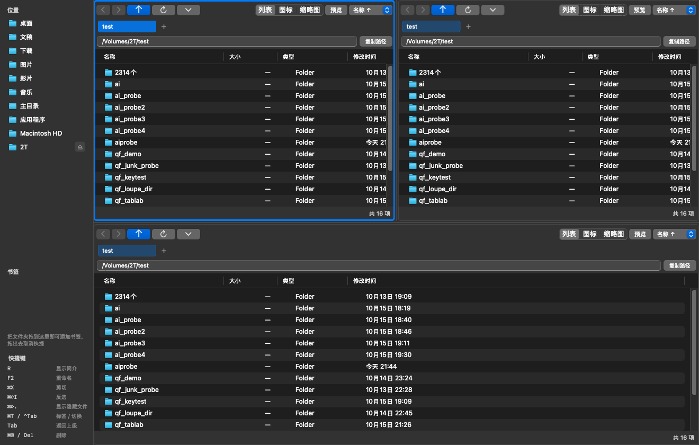
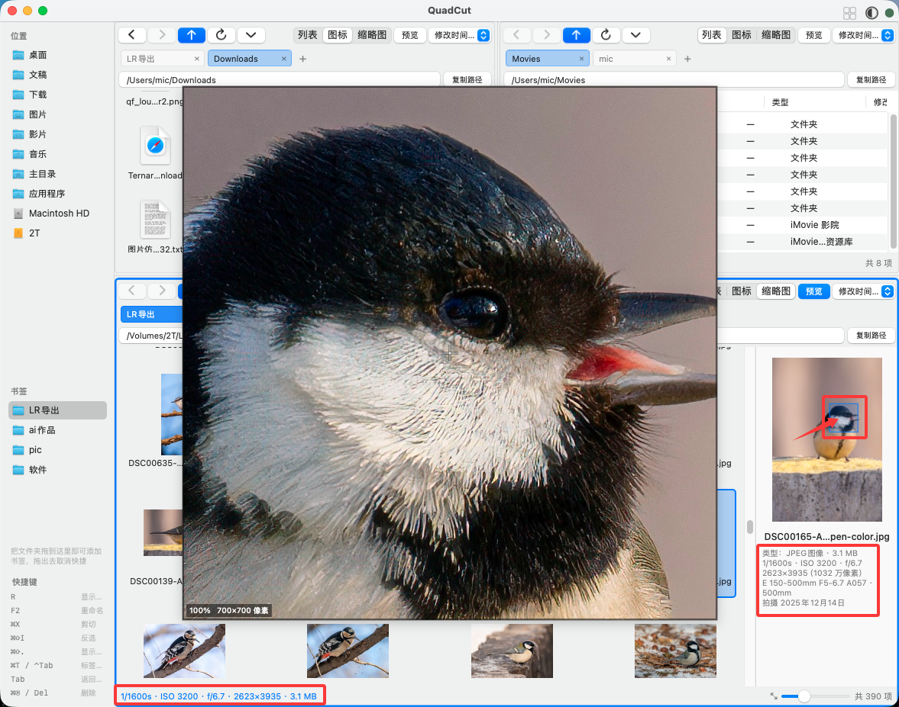
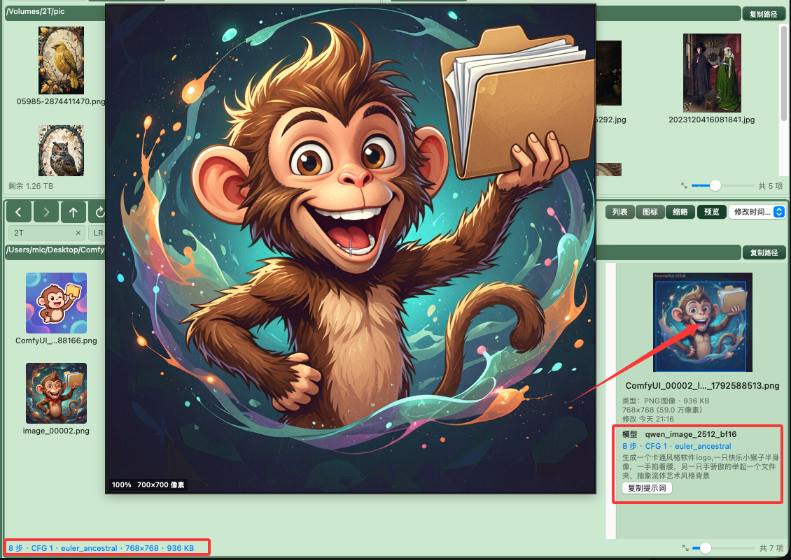
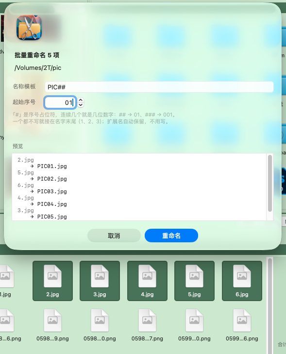
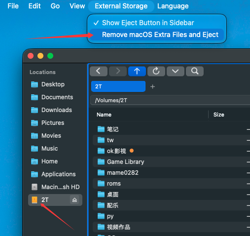
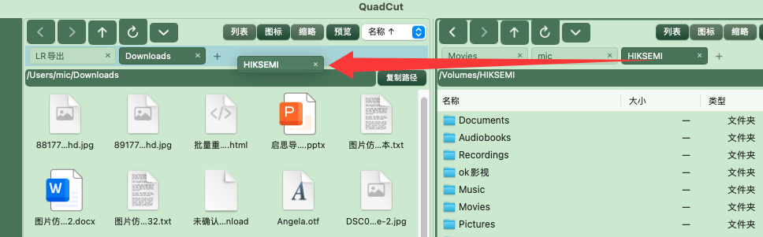

# QuadCut 快卡

**四宫格文件管理器，为快捷管理和方便筛选而生。**

简体中文 · [繁體中文](README.zh-TW.md) · [English](README.en.md) · [日本語](README.ja.md) · [한국어](README.ko.md)


刚开始用 Mac 的时候，我每天要处理大量照片和文件，脑子里全是同一串念头：我需要剪切键，我需要剪切键；我要快速对比文件大小；我要在 20 张连拍里一眼挑出对焦最准的那张，顺手比比文件大小；我还要一次批量重命名 30 张照片……

于是有了 QuadCut —— 在 AI agent 的协助下做出来的、对照片和图片友好的多宫格文件管理器。它兼顾一些 Windows 的快捷键习惯，核心是四格协同、自带剪切、批量重命名，以及按住一个键就能快速显示 100% 局部。

除了日常整理文件，它也为照片和 AI 图帮点小忙：自动读出 ISO、快门、光圈，识别并显示 AI 图（ComfyUI）的模型、采样器、提示词。界面有两套配色、五种语言。

---

## 四宫格，四种布局



四格并排，四种摆法，随时换。

## 剪切就是剪切

`⌘X` 标记，到目标格 `⌘V`，是**移动**，不是复制。

## 按一个键，快速查焦点

鼠标停在预览图上，按住 `⌃` 或 `⌥`，或只按中键，立刻弹出 100% 原尺寸放大镜。连拍里快速判断对焦准不准、快速筛片，这是最直接的办法。

## 照片参数快显



选中一张照片，状态栏直接写着快门、ISO、光圈和尺寸；预览侧栏里还有镜头、焦距和拍摄时间。

## AI 图的参数，直接读出来



选中 ComfyUI 或 A1111 生成的图，模型、步数、CFG、采样器、提示词直接读出来，旁边一颗按钮复制全文。

## 批量重命名



选中几项按 `F2`，`PIC##` 就是 `PIC01`、`PIC02`…… 要么全成，要么一个都不改。

## 外接盘清理：走之前把盘还干净



U 盘、移动硬盘在 Mac 上用过，会留下 `.DS_Store`、`._xxx`、`.Spotlight-V100` 这些隐藏文件 —— 换到 Windows 或别人的电脑上，就是一堆看不懂的垃圾。

菜单「外存储 → 移除 macOS 附加文件并推出」一次清掉再弹出，动手前会问你一句。侧边栏那颗 `⏏` 只是普通弹出，只弹不清。

## 标签可以拖来拖去



每格最多 6 个标签，能拖着换位置、拖到别的格子，也能直接拖进左侧栏变成书签。

## 字母快速检索定位

敲一个字母或数字，直接跳到首字符匹配的那一项；中文按拼音首字母。连按同一个键就一项项往下走。

---

## 其他

- 三档视图：详细列表 / 图标网格 / 大缩略图
- 搜索（`⌘F`）：当前目录及子目录，支持 `*` `?` 通配符
- 只看图片、按拍摄时间排序、编辑菜单里的旋转（JPG / HEIC / TIFF，只改 EXIF，不重新编码）
- 撤销 / 重做、恢复关闭的标签（`⇧⌘T`）
- 颜色标签与筛选，和访达是同一份数据
- 五种界面语言、两套主题
- 路径地址栏、显示简介、反选、在这里打开终端

---

## 安装

**系统要求**：macOS 13 Ventura 或更新，Apple Silicon（M 系列）。目前只发布 arm64 版本。

1. 下载后把 `QuadCut.app` 拖进「应用程序」
2. 首次打开如果提示「已损坏，无法打开」—— 这是没有 Apple 开发者签名导致的，程序本身没坏。打开「终端」跑一次：
   ```bash
   xattr -cr /Applications/QuadCut.app
   ```
   然后再双击就能打开。（如果提示的是「无法验证开发者」，去「系统设置 → 隐私与安全性」里点「仍要打开」。）
3. 首次运行请在「系统设置 → 隐私与安全性 → **完全磁盘访问权限**」里勾上 QuadCut。不勾的话读不到桌面、下载、文稿这些目录。

---

## 快捷键

| 操作           | 快捷键                             |
| ------------ | ------------------------------- |
| 返回上一级        | `Tab`（或 `⌘↑`）                   |
| 进入选中项        | `回车` / `⌘↓` / 双击                |
| 后退 / 前进      | `⌘[` / `⌘]`                     |
| 刷新           | `F5`                            |
| 剪切 / 复制 / 粘贴 | `⌘X` / `⌘C` / `⌘V`              |
| 复制一份         | `⌘D`                            |
| 移到废纸篓        | `Del`（PC 键帽）/ `⌘⌫`              |
| 新建文件夹        | `⇧⌘N`                           |
| 重命名 / 批量重命名  | `F2`                            |
| 显示简介         | `⌘R` / `⌥R`                     |
| 撤销 / 重做      | `⌘Z` / `⇧⌘Z`                    |
| 全选 / 反选      | `⌘A` / `⇧⌘I`                    |
| 显示隐藏文件       | `⌘⇧.`                           |
| 搜索           | `⌘F`                            |
| 定位到地址栏       | `⌘L`                            |
| 切换到第 1–4 格   | `⌘1`–`⌘4`                       |
| 切换视图         | `⌥⌘1` 列表 / `⌥⌘2` 图标 / `⌥⌘3` 缩略图 |
| 新建 / 切换标签    | `⌘T` / `⌃Tab`、`⌃⇧Tab`           |
| 恢复关闭的标签      | `⇧⌘T`                           |
| 快速预览         | `空格`                            |
| 按首字母跳转       | 裸字母 `A`–`Z`、数字 `0`–`9`          |
| 100% 看局部     | 悬停预览图，`⌃` / `⌥` / 中键              |
| 在这里打开终端      | `⌃⌘T`                           |

键位是按**键盘上印的字**分配的，不是照搬 Windows 的物理位置 —— PC 键盘和 Mac 键盘都能对上：返回上一级是 `Tab`，删除是 `Del` / `⌘⌫`。

---

**免费软件 · 版权所有 © 2026 Michael**

可免费使用，也可将本软件的完整原样副本免费分发，须保留本声明与完整程序。  
未经作者书面许可，不得修改、反编译、反向工程或用于衍生作品，不得以任何形式收费分发。  
本软件按「现状」提供，不附带任何明示或默示的担保，包括但不限于适销性与特定用途适用性。  
作者不对使用或无法使用本软件所造成的任何损失承担责任。

Copyright © 2026 Michael. All rights reserved.
